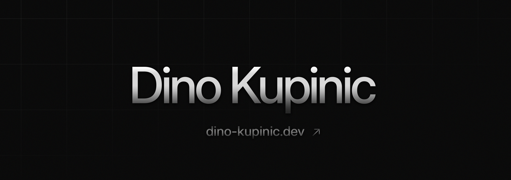

### Hi, I'm Dino

Web engineer in Vienna. Mostly frontend — React/Next.js, Vue/Nuxt, TypeScript, Tailwind.

Consulting at PwC Austria. Before that I co-founded a small real-estate AI startup. Looking for a product startup, remote is fine.

- [Tourney](https://github.com/Dino-Kupinic/tourney) — tournament app for HTL Steyr, 1000+ students. [Live](https://tourney.dino-kupinic.dev)
- [Sniptide](https://github.com/Dino-Kupinic/sniptide) — pastebin with a CLI and an API. [sniptide.com](https://sniptide.com)
- [blackrose](https://github.com/Dino-Kupinic/blackrose) — decision layer for LLM apps
- [logscope](https://github.com/Dino-Kupinic/logscope) — nginx log viewer
- df-malerei.at — client site

[Portfolio](https://dino-kupinic.dev) · [LinkedIn](https://www.linkedin.com/in/dinokupinic) · [Book a call](https://cal.com/dino-kupinic)
